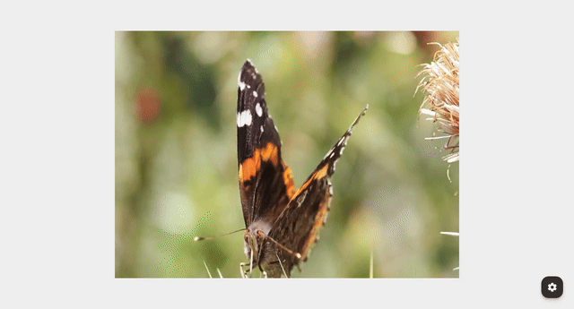
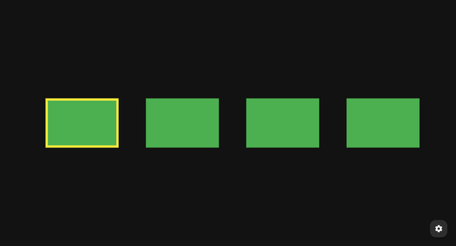
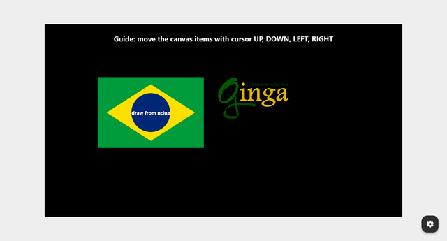
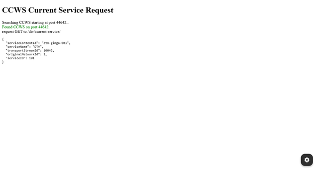
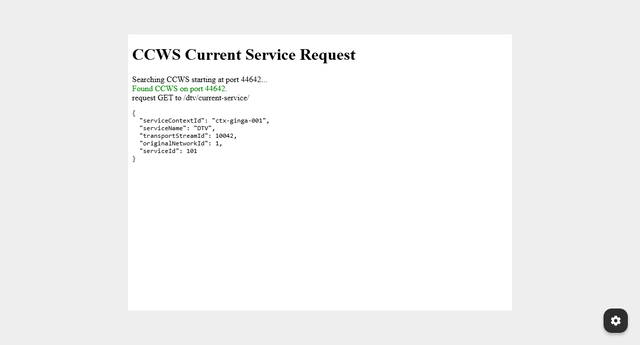
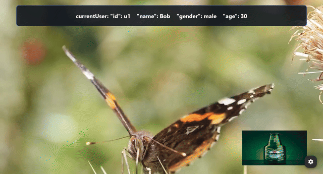
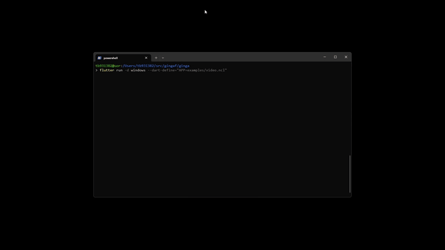
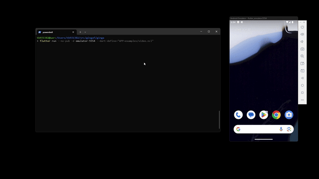
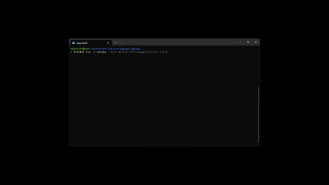
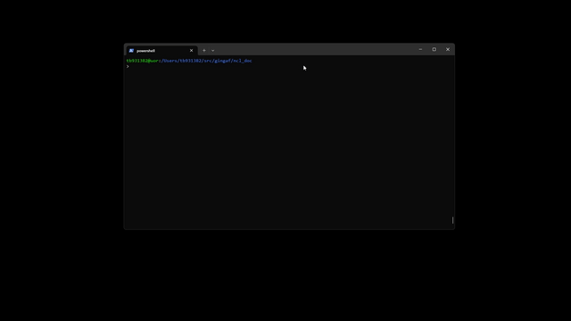

<header class="academic-header" markdown="1">
<h1 class="academic-title">gingaf: A Cross-Platform Architecture to Execute Ginga-NCL and Ginga-HTML5 Applications</h1>
<div class="academic-authors">
<div class="academic-author">
<div class="author-name">Alan L. V. Guedes</div>
<div class="author-inst">University of Reading</div>
</div>
<div class="academic-author">
<div class="author-name">Paulo Victor Borges</div>
<div class="author-inst">PUC-Rio</div>
</div>
<div class="academic-author">
<div class="author-name">Daniel Moraes</div>
<div class="author-inst">PUC-Rio</div>
</div>
<div class="academic-author">
<div class="author-name">Sergio Colcher</div>
<div class="author-inst">PUC-Rio</div>
</div>
</div>
<div class="academic-conference">WebMedia 2026</div>
<div class="academic-links" markdown="span">
<a class="academic-link-btn" href="https://doi.org/10.5753/webmedia.2026.30538">
:simple-doi: <span>DOI</span>
</a>
<a class="academic-link-btn" href="assets/pdfs/main.pdf">
:lucide-download: <span>Pre-print</span>
</a>
<a class="academic-link-btn" href="slides/">
:lucide-presentation: <span>Slides</span>
</a>
<a class="academic-link-btn" href="https://github.com/ginga-org-br/gingaf">
:simple-github: <span>Code Repo</span>
</a>
<a class="academic-link-btn" href="https://github.com/alanlivio/paper-gingaf-webmedia26">
:simple-github: <span>Paper Repo</span>
</a>
</div>
</header>

<div class="abstract-container" markdown="1">
<div class="abstract-inner" markdown="1">

## Abstract

The Ginga middleware, alongside its Ginga-NCL and Ginga-HTML5 subsystems, is an international standard for interactive digital television defined by the ITU-T/SBTDVD and used TV in Brazil and several Latin American countries. It reaches over 60 million people. However, traditional Ginga development tools rely on heavy, platform-specific C++ implementations, creating a steep barrier to entry for developers. This paper presents <span style="font-variant: small-caps;">gingaf</span>, a Ginga architecture support running both Ginga-NCL and Ginga-HTML5 applications directly from web browser, mobile or desktop. By decoupling the headless NCL state from the user interface, <span style="font-variant: small-caps;">gingaf</span> allows developers to execute synchronization logic deterministically while rendering seamlessly via pure Web HTML/JS. We present the extended architecture supporting imperative subsystems, including a pure Dart Lua interpreter (lua_dardo) translating canvas instructions, and a cross-platform HTML player that intercepts network requests via fetch overloading for Ginga-CCWebservices. This architecture does not require any native browser plugins, paving the way for web-based Ginga playgrounds and interactive debugging environments.

</div>
</div>

## Selected Applications

<table>
  <tbody>
    <tr>
      <td align="center" width="50%">
        <br />
        NCL with basic links (<a href="https://ginga.org.br/gingaf/playground/?app=video.ncl">video.ncl</a>)
      </td>
      <td align="center" width="50%">
        <br />
        NCL with videos grid (<a href="https://ginga.org.br/gingaf/playground/?app=video_grid.ncl">video_grid.ncl</a>)
      </td>
    </tr>
    <tr>
      <td align="center" width="50%">
        <br />
        NCL embedded with NCL (<a href="https://ginga.org.br/gingaf/playground/?app=emb_ncl.ncl">emb_ncl.ncl</a>)
      </td>
      <td align="center" width="50%">
        <br />
        NCL with focus navigation and selection (<a href="https://ginga.org.br/gingaf/playground/?app=focus_nav.ncl">focus_nav.ncl</a>)
      </td>
    </tr>
    <tr>
      <td align="center" width="50%">
        <br />
        NCL with lua canvas drawing and keys (<a href="https://ginga.org.br/gingaf/playground/?app=lua_canvas.ncl">lua_canvas.ncl</a>)
      </td>
      <td align="center" width="50%">
        <br />
        HTML with CCWS /current-service/ (<a href="https://ginga.org.br/gingaf/playground/?app=current_service.html">current_service.html</a>)
      </td>
    </tr>
    <tr>
      <td align="center" width="50%">
        <br />
        NCL with embedded HTML document (<a href="https://ginga.org.br/gingaf/playground/?app=emb_html.ncl">emb_html.ncl</a>)
      </td>
      <td align="center" width="50%">
        <br />
        NCL with multi-user profile switching and targeted advertising (<a href="https://ginga.org.br/gingaf/playground/?app=multiuser_profile/main.ncl">multiuser_profile/main.ncl</a>)
      </td>
    </tr>
  </tbody>
</table>

## Multi-platform Demos

<table>
  <tbody>
    <tr>
      <td align="center" width="50%">
        <br />
        Windows
      </td>
      <td align="center" width="50%">
        <br />
        Android
      </td>
    </tr>
    <tr>
      <td align="center" width="50%">
        <br />
        Chrome
      </td>
      <td align="center" width="50%">
        <br />
        CLI (headless execution)
      </td>
    </tr>
  </tbody>
</table>

## Citation

```bibtex
@inproceedings{webmedia,
 author = {Alan L. V. Guedes and Paulo Victor Borges and Daniel Moraes and Sergio Colcher},
 title = { gingaf: A Cross-Platform Architecture to Execute Ginga-NCL and Ginga-HTML5 Applications},
 booktitle = {Proceedings of the 32nd Brazilian Symposium on Multimedia and the Web},
 location = {Lavras/MG},
 year = {2026},
 keywords = {},
 issn = {0000-0000},
 pages = {254--261},
 publisher = {SBC},
 address = {Porto Alegre, RS, Brasil},
 doi = {10.5753/webmedia.2026.30538},
 url = {https://sol.sbc.org.br/index.php/webmedia/article/view/46098}
}
```

<footer class="academic-footer md-typeset">
<p>Built with <a href="https://zensical.org" rel="nofollow">Zensical</a> based on <a href="https://research-template.roman.technology" rel="nofollow">Roman Hauksson-Neill's project page template</a></p>
</footer>
