

<!-- _paginate: false -->
<!-- _header: "" -->

# gingaf: A Cross-Platform Architecture To Execute Ginga-NCL and Ginga-HTML5 Applications

**Alan L. V. Guedes**$^1$, **Paulo Victor Borges**$^2$, **Daniel Moraes**$^2$, **Sergio Colcher**$^2$
$^1$University of Reading, UK | $^2$PUC-Rio, BR

*Anais do Simpósio Brasileiro de Sistemas Multimídia e Web (WebMedia 2026)*
Lavras/MG, BR

**Website do Artigo (slides, código, demo)**:
https://alanlivio.github.io/paper-webmedia26-gingaf/

---

# Spoiler Alert!

## Esta apresentação vai para o Guinness Book de 2027 💪

---

<!-- _class: invert -->
<!-- _paginate: skip -->

# Contexto e Definição do Problema

---

# O Middleware de DTV Ginga

  

    

      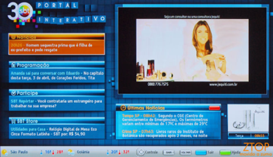
    

    

      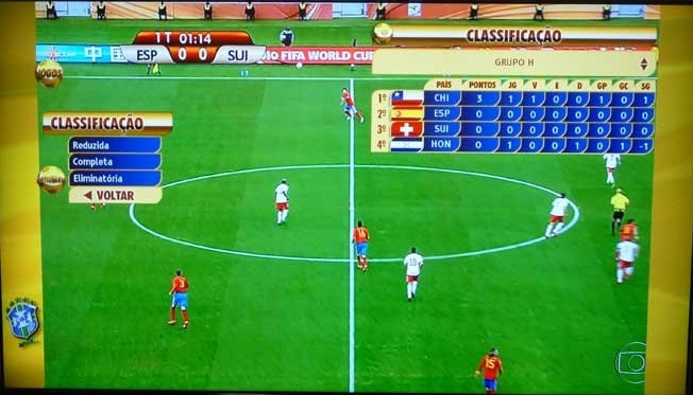
    

  

  

    

      
    

    

      
    

  

Definido na série de normas SBTVD ABNT 15606.

Presente em receptores de TV Digital certificados no Brasil e América Latina (>60M telespectadores)

---

# Ecossistema de Desenvolvimento Ginga é limitado

**Ausência de ambiente portátil e "zero-install"**: de fácil acesso, completo e aberto.
- Podemos comparar o Mozilla https://developer.mozilla.org/ e a Ginga-VM (2010)

  
  

---

# Ecossistema de Desenvolvimento Ginga é limitado

**Um fator é a escolha da Engine Gráfica** (e.g., DirectFrameBuffer, FFmpeg, GStreamer, Browsers)

**Outro fator é a complexidade de certos componentes do Ginga**: NCLua (C-based lua engine), Ginga-HTML5 (chromium, webkit) e Ginga-CC-Webservices (HTTP server).

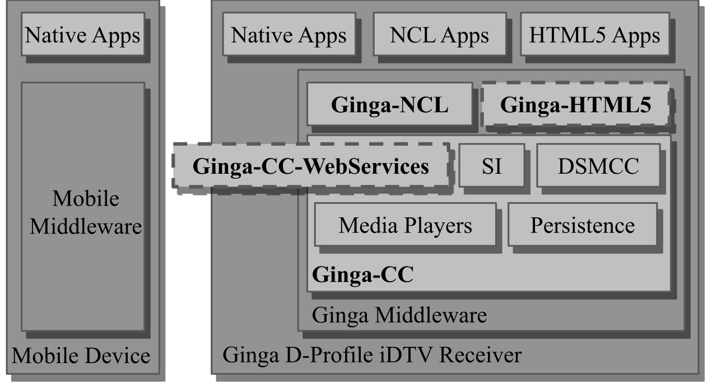

---

# Implementações do Ginga na Literatura

  

  

  
  

    
      1998
    
  

  

    
      2001
    
  

  

    
      2010
    
  

<h3 style="margin: 0 0 2px 0; color: #0969da; font-size: 21px; font-weight: 700;">PUC-Rio (Netscape)</h3>

[Rodrigues et al. 1998]

  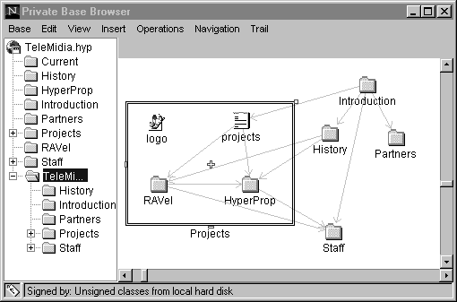

Plugin para navegador Netscape no início da WWW.

browser-only sem Lua

<h3 style="margin: 0 0 2px 0; color: #0969da; font-size: 21px; font-weight: 700;">PUC-Rio (Java AWT)</h3>

[Rodrigues et al. 2001]

  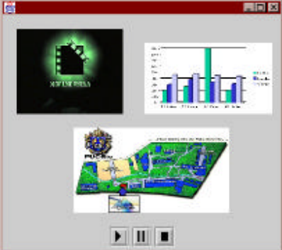

Ferramentas de exibição hipermídia sobre Java AWT.

desktop-only sem Lua

<h3 style="margin: 0 0 2px 0; color: #0969da; font-size: 21px; font-weight: 700;">PUC-Rio (C++ &amp; FFmpeg)</h3>

[Soares et al. 2010]

  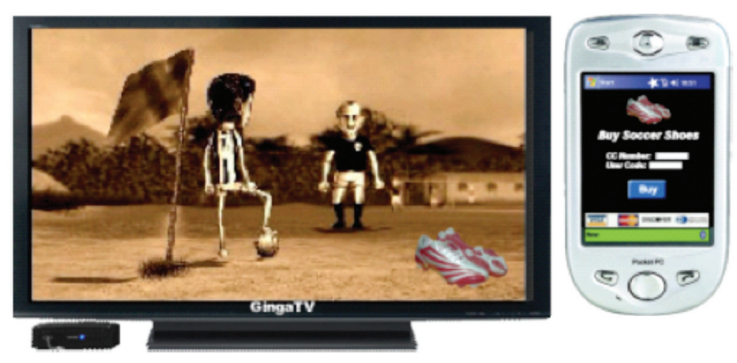

Middleware declarativo com backend FFmpeg para IPTV/DTV.

desktop-only

---

# Implementações do Ginga na Literatura

  

  

  
  

    
      2012
    
  

  

    
      2018
    
  

  

    
      2018–2020
    
  

<h3 style="margin: 0 0 2px 0; color: #0969da; font-size: 21px; font-weight: 700;">UFSCar (WebNCL)</h3>

[Melo et al. 2013]

  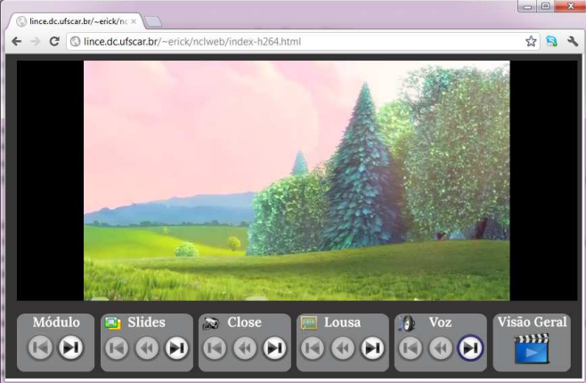

Apresentador web puramente em JavaScript.

browser-only sem Lua

<h3 style="margin: 0 0 2px 0; color: #0969da; font-size: 21px; font-weight: 700;">PUC-Rio (C++ &amp; GStreamer)</h3>

[PUC-Rio / Telemídia]

  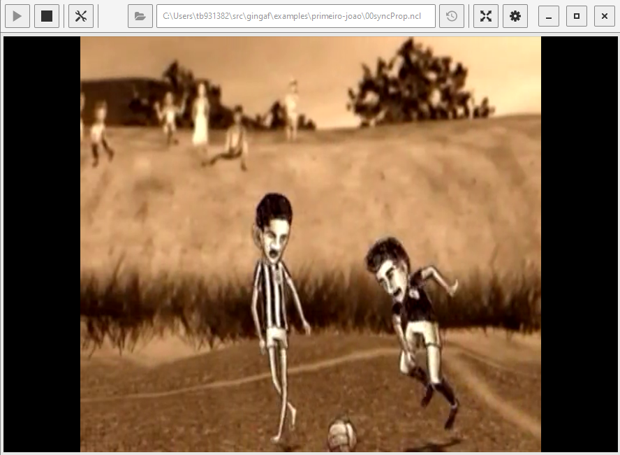

Reimplementação C++ com <code>tick()</code> e GStreamer.

desktop-only sem Ginga-CC-Webservices

<h3 style="margin: 0 0 2px 0; color: #0969da; font-size: 21px; font-weight: 700;">Sidia NuGinga (NodeJS)</h3>

[Braga et al. 2018; Nogueira et al. 2020]

  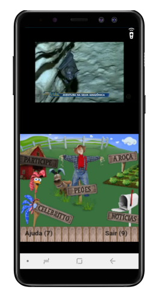
  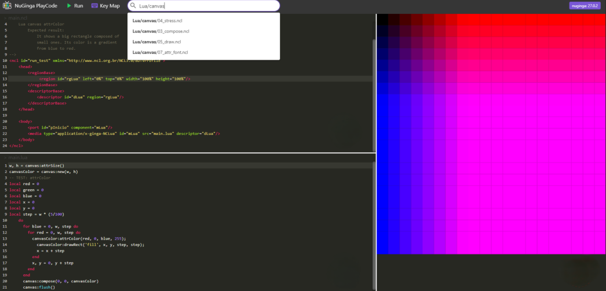

Middleware JS/Android e ferramenta web Playcode.

browser-only sem Ginga-CC-Webservices

---

# Implementações do Ginga na Literatura

  

    <ul style="margin: 0; padding: 0; list-style: none; font-size: 20px; line-height: 1.8; color: #24292f; text-align: center;">
      <li><strong>PUC-Rio (Java AWT)</strong></li>
      <li><strong>PUC-Rio (C++ &amp; FFmpeg)</strong></li>
      <li><strong>PUC-Rio (C++ &amp; GStreamer)</strong></li>
    </ul>
  

  

  

    <ul style="margin: 0; padding: 0; list-style: none; font-size: 20px; line-height: 1.8; color: #24292f; text-align: center;">
      <li><strong>PUC-Rio (Netscape)</strong></li>
      <li><strong>UFSCar (WebNCL)</strong></li>
      <li><strong>Sidia NuGinga (NodeJS)</strong></li>
    </ul>
  

  

    
Native

    

      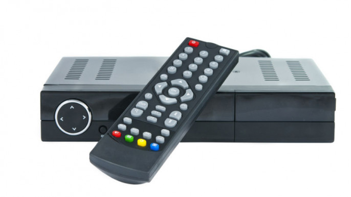
      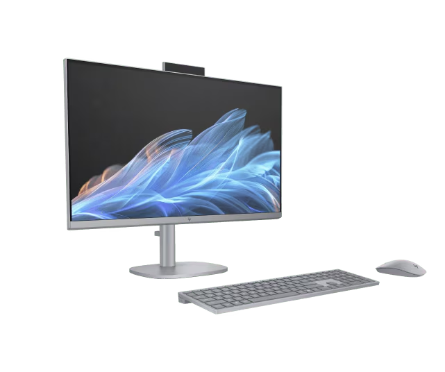
    

  

  

    
Browser

    
  

---
<!-- _class: invert -->
<!-- _paginate: skip -->

# Solução Proposta

---

# Solução Proposta: gingaf

As principais decisões de design são:

  

    <strong>1. Engine Gráfica Multiplataforma</strong>
  

  

    Código único em Dart/Flutter para execução consistente na Web, Desktop e Mobile.
  

  

    <strong>2. UI e Modelos Desacoplados</strong>
  

  

    Lógica (<code>NCLDocument</code>) independente e isolada de rendering.
  

  

    <strong>3. Relógio Virtual</strong>
  

  

    Avanço temporal determinístico orquestrado via <code>tick()</code>, eliminando condições de corrida.
  

  

    <strong>4. NCLua e CCWS Portáveis</strong>
  

  

    Runtime Lua puro em Dart e virtualização de rede sem dependências nativas.
  

---

<!-- _paginate: hold -->

# 1. Engine Gráfica Multiplataforma

  

    <ul style="margin: 0; padding: 0; list-style: none; font-size: 20px; line-height: 1.8; color: #24292f; text-align: center;">
      <li><strong>PUC-Rio (Java AWT)</strong></li>
      <li><strong>PUC-Rio (C++ &amp; FFmpeg)</strong></li>
      <li><strong>PUC-Rio (C++ &amp; GStreamer)</strong></li>
    </ul>
  

  

    
gingaf (ours)

    

      Ginga-NCL + Ginga-HTML5
    

  

  

    <ul style="margin: 0; padding: 0; list-style: none; font-size: 20px; line-height: 1.8; color: #24292f; text-align: center;">
      <li><strong>PUC-Rio (Netscape)</strong></li>
      <li><strong>UFSCar (WebNCL)</strong></li>
      <li><strong>Sidia NuGinga (NodeJS)</strong></li>
    </ul>
  

  

    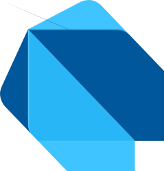
    Dart
  

  /
  

    
    Flutter
  

  

    
Native

    

      
      
    

  

  

    
Browser

    
  

---

# 1. Engine Gráfica Multiplataforma

  

    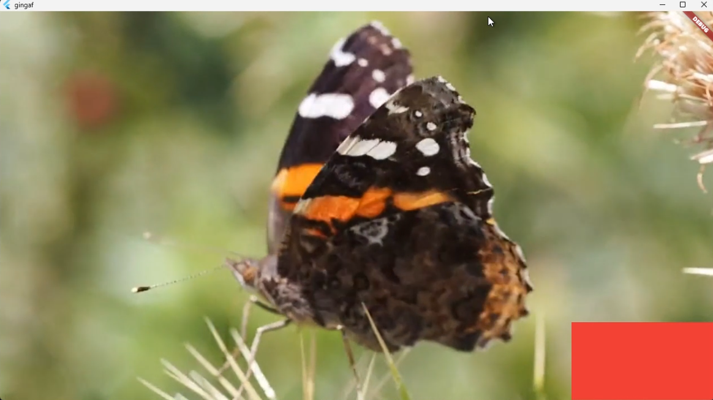
    
Desktop

  

  

    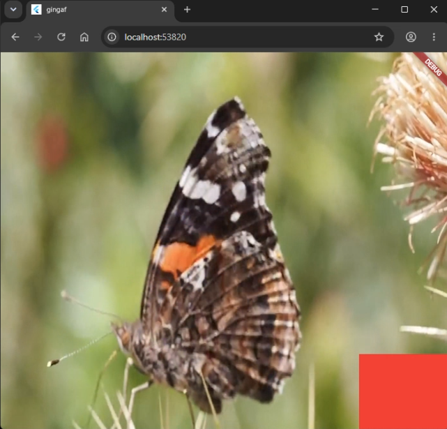
    
Web

  

  

    
    
Mobile

  

---

# 2. UI e Modelos Desacoplados

**Camada de Lógica (Dart Puro)**
- `NCLDocument` (Parser, runtime NCLua) e `CCWS`.
- Compila para JavaScript e WebAssembly.

**Camada de Apresentação (Flutter)**
- `NCLWidget` e `HTMLWidget` (webview, js-interop).
- Renderização com precisão de pixels na Web, desktop e mobile.

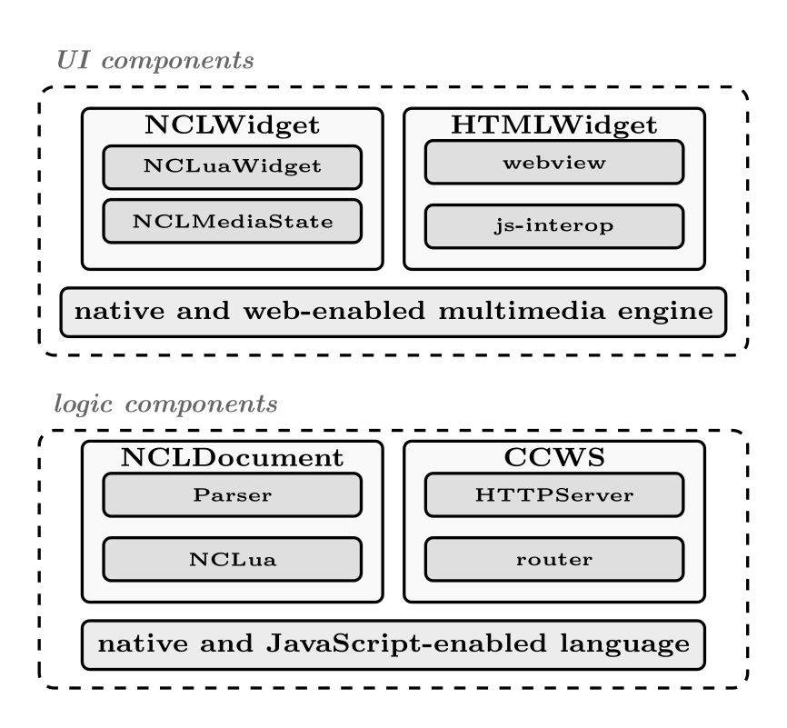

---

# 3. Relógio Virtual

## Implementações Anteriores Sem Relógio Virtual

- Tempo atrelado ao relógio e threads do SO.
- Máquina de estados bloqueada por chamadas `draw()`.
- Transições disparadas via `onEvent()` nativo.

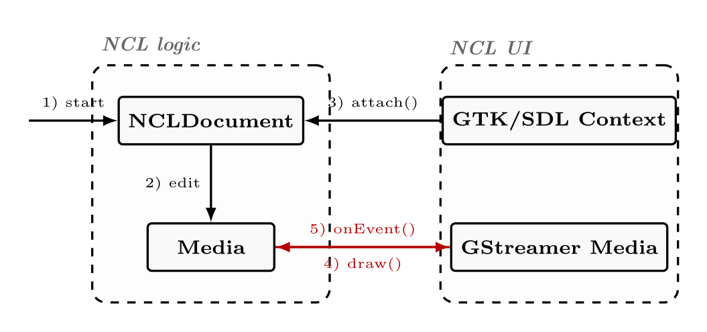

---

# 3. Relógio Virtual

- **Coordenação por `tick()`**: O `NCLWidget` avança o relógio virtual por pulsos explícitos.
- **Desacoplamento de UI**: Sem referência direta entre `NCLDocument` e widgets da UI.
- **Sincronização Determinística**: Estados de `Media` atualizados na ordem do documento.
- **Consulta sob Demanda**: UI obtém propriedades via `syncProperties()`, sem condições de corrida.

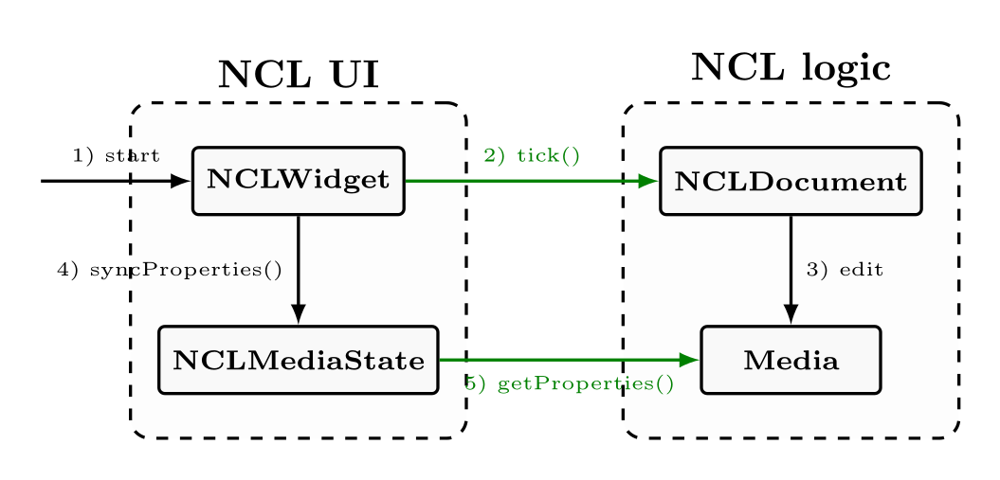

---

# 4. NCLua Portável

- **Motor Lua em Dart Puro**: `lua_dardo` (Lua 5.3) na Web sem dependências C ou Wasm.
- **Abstração de Comandos**: Chamadas `canvas` despachadas para o `CustomPainter` do Flutter.
- **Corrotinas Assíncronas**: Mapeadas para `async/await` sem bloquear o `tick()`.
- **Paridade Multiplataforma**: Saída visual idêntica na Web (WebGL), Desktop e Mobile.

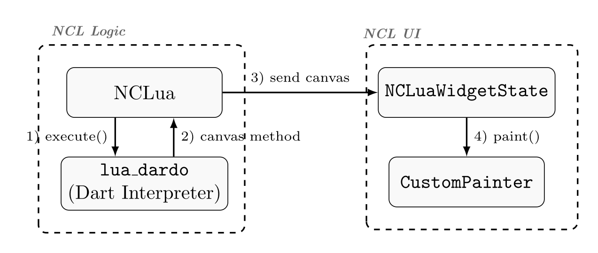

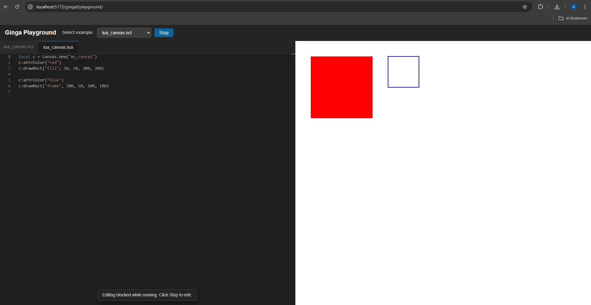

---

# 4. Ginga-CC-WebServices Portável

**Nativo (a)**
- Aplicação HTML executa em WebView nativa.
- `HTTPServer` local embutido (porta 44642) atende requisições HTTP.

**Navegador com Sandbox (b)**
- Aplicação HTML executa em `iframe` com sandbox.
- Shim injetado intercepta `window.fetch()` e `XMLHttpRequest`.

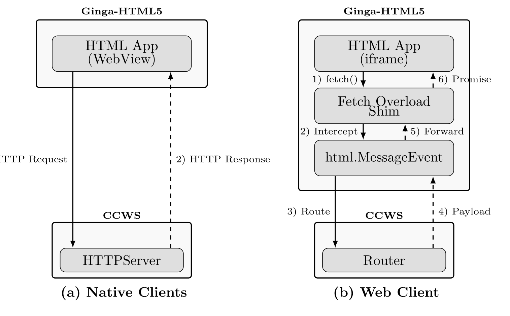

---

<!-- _class: invert -->
<!-- _paginate: skip -->

# Funcionalidades e Demo do gingaf

---

## NCL com Links, Grade de Vídeos, NCL Embutido e Navegação

  

    
    
NCL com links básicos (<a href="https://ginga-org-br.github.io/gingaf/playground/?app=video.ncl">video.ncl</a>)

  

  

    
    
NCL com grade de vídeos (<a href="https://ginga-org-br.github.io/gingaf/playground/?app=video_grid.ncl">video_grid.ncl</a>)

  

  

    
    
NCL embutido em NCL (<a href="https://ginga-org-br.github.io/gingaf/playground/?app=emb_ncl.ncl">emb_ncl.ncl</a>)

  

  

    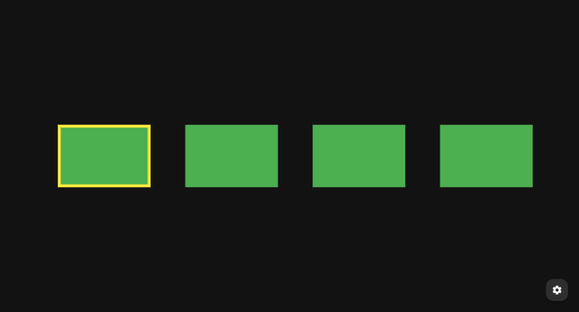
    
NCL com navegação de foco e seleção (<a href="https://ginga-org-br.github.io/gingaf/playground/?app=focus_nav.ncl">focus_nav.ncl</a>)

  

---

## NCLua, HTML+CCWS, HTML Embutido e Multiusuário

  

    
    
NCL com desenho em tela Lua e teclas (<a href="https://ginga-org-br.github.io/gingaf/playground/?app=lua_canvas.ncl">lua_canvas.ncl</a>)

  

  

    
    
HTML com CCWS /current-service/ (<a href="https://ginga.org.br/gingaf/playground/?app=current_service.html">current_service.html</a>)

  

  

    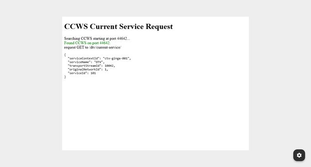
    
NCL com documento HTML embutido (<a href="https://ginga-org-br.github.io/gingaf/playground/?app=emb_html.ncl">emb_html.ncl</a>)

  

  

    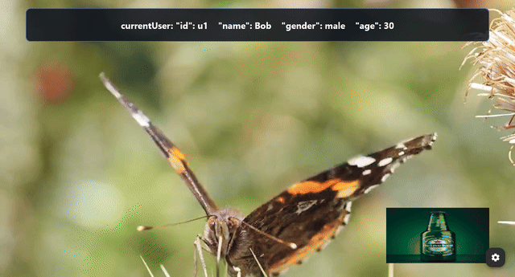
    
NCL com troca de perfil multiusuário e publicidade direcionada (<a href="https://ginga-org-br.github.io/gingaf/playground/?app=multiuser_profile/main.ncl">multiuser_profile/main.ncl</a>)

  

---

# Esta apresentação vai para o Guinness Book de 2027?

---

# Esta apresentação vai para o Guinness Book de 2027?

## Primeiro exemplo de NCL forward na história!

  

---

<!-- _class: contrib-slide -->

# Contribuições

Decisões de Arquitetura

  

    <strong>1. Engine Gráfica</strong>
    
Dart/Flutter unificado

  

  

    <strong>2. UI Desacoplada</strong>
    
Lógica headless em memória

  

  

    <strong>3. Relógio Virtual</strong>
    
Avanço via tick()

  

  

    <strong>4. NCLua &amp; CCWS</strong>
    
Lua e CCWS virtualizados

  

---

<!-- _class: contrib-slide -->

# Contribuições

## Portabilidade Multiplataforma

  

    <ul style="font-size: 23px; line-height: 1.55; color: #24292f; margin: 0; padding-left: 24px;">
      <li>Suporte a <strong>Desktop</strong>, <strong>Web</strong> e <strong>Android</strong></li>
      <li>Pronto para <strong>dispositivos futuros</strong> (ex.: TVs com suporte a Flutter)</li>
    </ul>
  

  

    

      
      Desktop
    

    

      
      Web
    

    

      
      Mobile
    

  

Decisões de Arquitetura

  

    <strong>1. Engine Gráfica</strong>
    
Dart/Flutter unificado

  

  

    <strong>2. UI Desacoplada</strong>
    
Lógica headless em memória

  

  

    <strong>3. Relógio Virtual</strong>
    
Avanço via tick()

  

  

    <strong>4. NCLua &amp; CCWS</strong>
    
Lua e CCWS virtualizados

  

---

<!-- _class: contrib-slide -->

# Contribuições

## Determinismo

  

    <ul style="font-size: 23px; line-height: 1.5; color: #24292f; margin: 0; padding-left: 24px;">
      <li>Modo <strong>headless</strong> em memória</li>
      <li>Avanço por <code>tick()</code> orquestrado</li>
      <li><strong>64 testes unitários</strong> em CI</li>
    </ul>
  

  

    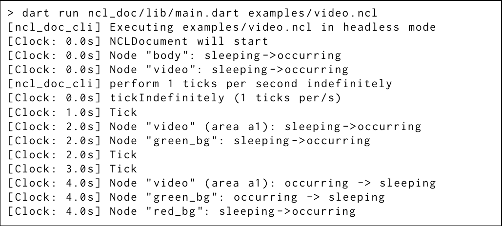
  

Decisões de Arquitetura

  

    <strong>1. Engine Gráfica</strong>
    
Dart/Flutter unificado

  

  

    <strong>2. UI Desacoplada</strong>
    
Lógica headless em memória

  

  

    <strong>3. Relógio Virtual</strong>
    
Avanço via tick()

  

  

    <strong>4. NCLua &amp; CCWS</strong>
    
Lua e CCWS virtualizados

  

---

<!-- _class: contrib-slide -->

# Contribuições

## Debug

  

    <ul style="font-size: 23px; line-height: 1.5; color: #24292f; margin: 0; padding-left: 24px;">
      <li>Extensão <strong>ginga-code</strong> para VS Code</li>
      <li>Inspeção <strong>passo a passo</strong> (step)</li>
      <li>Sem necessidade de hardware STB</li>
    </ul>
  

  

    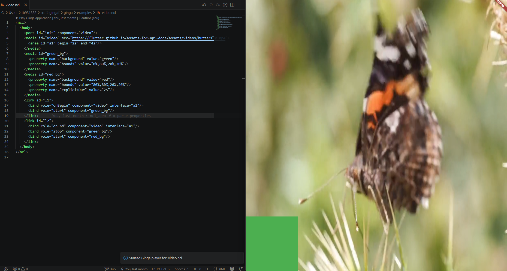
  

Decisões de Arquitetura

  

    <strong>1. Engine Gráfica</strong>
    
Dart/Flutter unificado

  

  

    <strong>2. UI Desacoplada</strong>
    
Lógica headless em memória

  

  

    <strong>3. Relógio Virtual</strong>
    
Avanço via tick()

  

  

    <strong>4. NCLua &amp; CCWS</strong>
    
Lua e CCWS virtualizados

  

---

# Referências

- **[Rodrigues et al. 1998]** Rogério Ferreira Rodrigues, Débora C. Muchaluat-Saade, and Luiz Fernando Gomes Soares. "Composite nodes, contextual links and graphical structural views on the WWW." *Journal of the Brazilian Computer Society*, 5(2), 1998.
- **[Rodrigues et al. 2001]** Rogério Ferreira Rodrigues, Leandro Marques Rodrigues, and Luiz Fernando Gomes Soares. "Desenvolvimento e Integração de Ferramentas de Exibição em Sistemas de Apresentação Hipermídia." *VII Simpósio Brasileiro de Sistemas Multimídia e Hipermídia (SBMídia 2001)*, Florianópolis, SC, 2001.
- **[Soares et al. 2010]** Luiz Fernando Gomes Soares, Carlos de Salles Soares Neto, Rogério Ferreira Rodrigues, and Marcelo Ferreira Moreno. "Ginga-NCL: Declarative middleware for multimedia IPTV services." *IEEE Communications Magazine*, 48(6): 74–81, 2010.
- **[Melo et al. 2013]** Erick Lazaro Melo, Caio César Viel, Cesar A. C. Teixeira, Alexandre Coelho Rondon, and Daniel de Paula Silva. "WebNCL: a web-based presentation machine for multimedia documents." *Proceedings of the 19th Brazilian Symposium on Multimedia and the Web (WebMedia 2013)*, 2013.
- **[Braga et al. 2018]** Rodrigo Braga, Volnei Klehm, Leonardo Santana, Kevin Takano, Lauro Gama, Addison Lima, Vinícius Melo, Taynara Paiva, Diego Gonzalez, Michael Mello, Chak Lee, and Lois Nascimento. "NuGinga: a JavaScript Driven Implementation of Brazilian Digital TV Middleware for Android." *Proceedings of the 24th Brazilian Symposium on Multimedia and the Web (WebMedia 2018)*, Salvador, Brazil, 2018.
- **[Nogueira et al. 2020]** Dina Nogueira, Lois Nascimento, Michael Mello, and Rodrigo Braga. "NuGinga Playcode: A web NCL/NCLua authoring tool for Ginga-NCL digital TV applications." *Proceedings of the 26th Brazilian Symposium on Multimedia and the Web (WebMedia 2020)*, 2020.

---

<!--
_paginate: false
_header: ""
-->

# Obrigado!

### Dúvidas e Discussão

- **Repositório**: https://github.com/ginga-org-br/gingaf
- **Playground**: https://ginga-org-br.github.io/gingaf/playground/
- **Contato**: `a.guedes@reading.ac.uk` | `danielmoraes@telemidia.puc-rio.br`

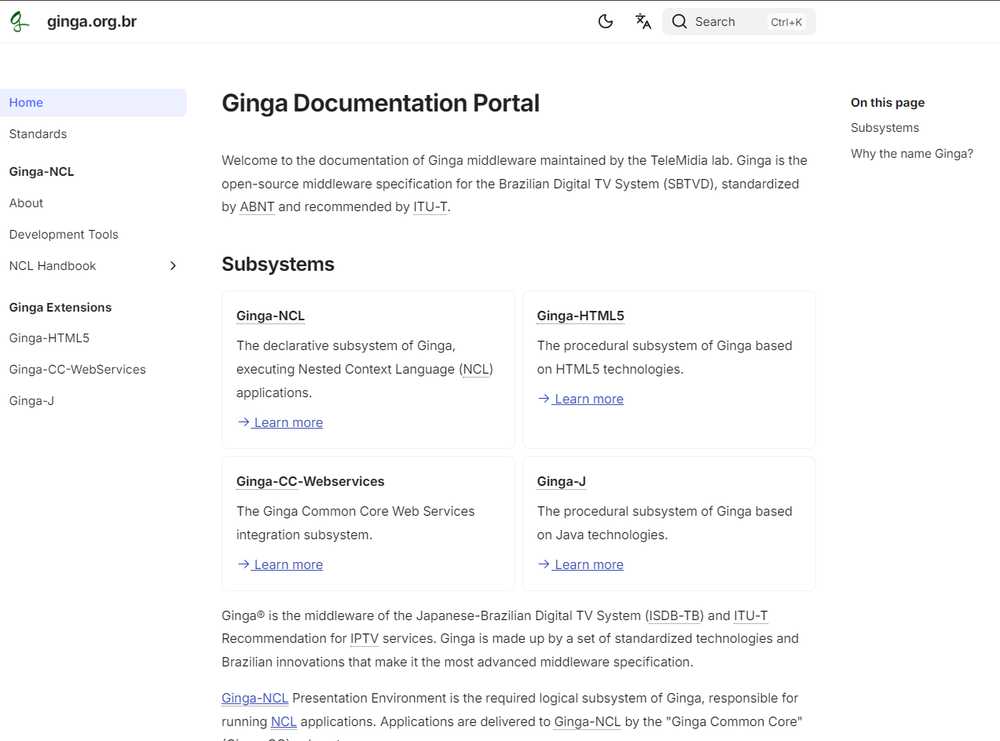

