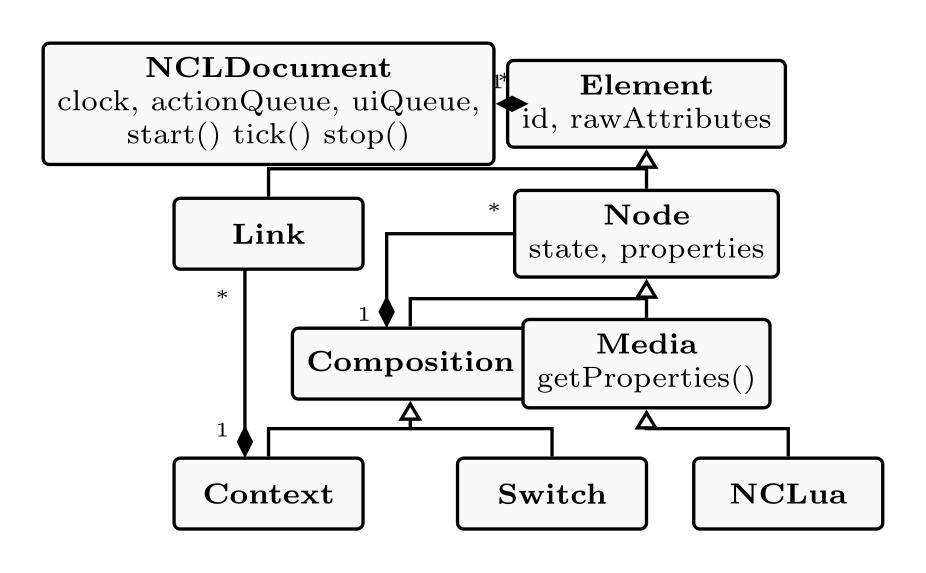
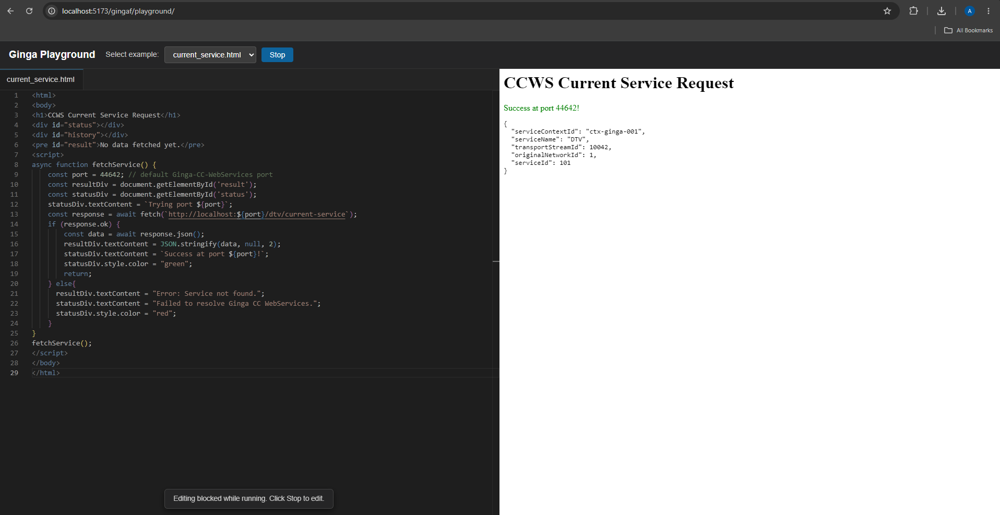
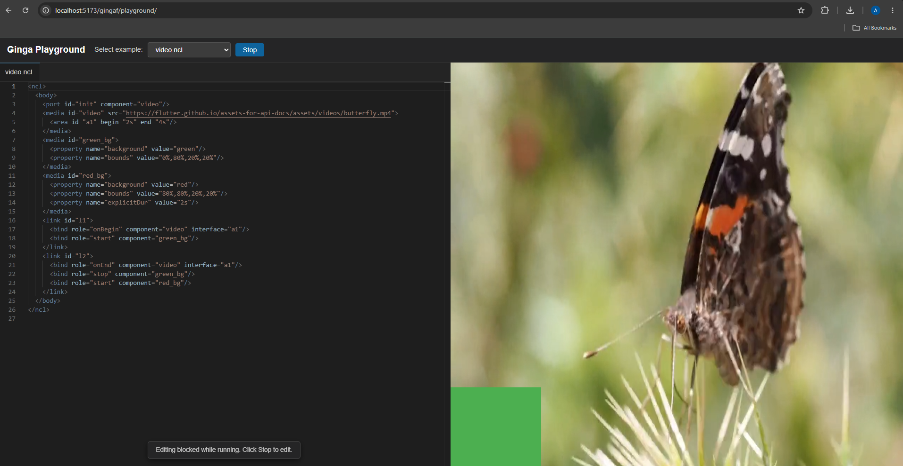

<!-- _paginate: false -->
<!-- _header: "" -->

# gingaf: A Cross-Platform Architecture To Execute Ginga-NCL and Ginga-HTML5 Applications

**Alan L. V. Guedes**$^1$, **Paulo Victor Borges**$^2$, **Daniel Moraes**$^2$, **Sergio Colcher**$^2$
$^1$University of Reading, UK | $^2$PUC-Rio, BR

*Anais do Simpósio Brasileiro de Sistemas Multimídia e Web (WebMedia 2026)*
Lavras/MG, BR

**Website do Artigo (slides, código, demo)**:
https://alanlivio.github.io/paper-webmedia26-gingaf/

---

# Agenda

- **Contexto e Definição do Problema**
- **Solução Proposta**
- **Funcionalidades e Demo do gingaf**
- **Considerações Finais**

---

<!-- _class: invert -->
<!-- _paginate: skip -->

# Contexto e Definição do Problema

---

# O Middleware de DTV Ginga

  

    

      
    

    

      
    

  

  

    

      
    

    

      
    

  

Definido na serie de normas SBTVD ABNT 15606.

Presente receptores de TV Digital certificados no Brasil e América Latina (>60M telespectadores)

---

# Ecosistema de Desenvolvimento Ginga é limatado

Não existe um ambiente desenvolve fácil acesso, completo e aberto. Por exemple o Mozilla https://developer.mozilla.org/

---

# Ecosistema de Desenvolvimento Ginga é limatado

- **Sem Execução Imediata e Setup dicifil**: Ausência de ambiente portátil e "zero-install".
- **Foco Acadêmico**: Foco em pesquisas.

**Desafios Técnicos de Cobertura da Normal**
- Além de Ginga-NCL e NCLua novos componentes HTML5 and Ginga-CC-Websservices increementam complexidade.

---

# Implementações do Ginga na Literatura

  

  

  
  

    
      1998
    
  

  

    
      2001
    
  

  

    
      2010
    
  

<h3 style="margin: 0 0 6px 0; color: #0969da; font-size: 21px; font-weight: 700;">PUC-Rio (Netscape)</h3>

  

Plugin para navegador Netscape no início da WWW.

[Rodrigues et al. 1998]

<h3 style="margin: 0 0 6px 0; color: #0969da; font-size: 21px; font-weight: 700;">PUC-Rio (Java AWT)</h3>

  

Ferramentas de exibição hipermídia sobre Java AWT.

[Rodrigues et al. 2001]

<h3 style="margin: 0 0 6px 0; color: #0969da; font-size: 21px; font-weight: 700;">PUC-Rio (C++ &amp; FFmpeg)</h3>

  

Middleware declarativo com backend FFmpeg para IPTV/DTV.

[Soares et al. 2010]

---

# Implementações do Ginga  na Literatura

  

  

  
  

    
      2012
    
  

  

    
      2018
    
  

  

    
      2018–2020
    
  

<h3 style="margin: 0 0 6px 0; color: #0969da; font-size: 21px; font-weight: 700;">UFSCar (WebNCL)</h3>

  

Apresentador web puramente em JavaScript (sem Lua).

[Melo et al. 2013]

<h3 style="margin: 0 0 6px 0; color: #0969da; font-size: 21px; font-weight: 700;">PUC-Rio (C++ &amp; GStreamer)</h3>

  

Reimplementação C++ com <code>tick()</code> e GStreamer.

[PUC-Rio / Telemídia]

<h3 style="margin: 0 0 6px 0; color: #0969da; font-size: 21px; font-weight: 700;">Sidia NuGinga (NodeJS)</h3>

  
  

Middleware JS/Android e ferramenta web Playcode.

[Braga et al. 2018; Nogueira et al. 2020]

---

# Limitações das Implementações Ginga na Literatura

**Acoplamento à Plataforma**
- **Concorrência por Eventos**: Callbacks assíncronos e chamadas bloqueantes de SO.
- **Dependência Nativa**: C++ acoplado a bibliotecas e codecs (FFmpeg, GTK).
- **Sobrecarga de VMs**: Máquinas virtuais pesadas para contornar dependências.

**Limitações Web e Código Fechado**
- **Suporte Web Parcial**: WebNCL sem suporte a NCLua nem CCWS.
- **Código Fechado**: NuGinga/Playcode fechados para a comunidade.
- **Fragmentação**: Falta de paridade unificada entre Web e Desktop.

<strong>Gargalos históricos</strong>: concorrência assíncrona complexa, dependência de codecs nativos, suporte web parcial e falta de código aberto.

---

<!-- _class: invert -->
<!-- _paginate: skip -->

# Solução Proposta

---

# Solução proposta

  

  

  

  

    
Native

    
  

  

    
Browser

    
  

---

<!-- _paginate: hold -->

# Implementações do Ginga na Literatura

  

    <ul style="margin: 0; padding-left: 20px; font-size: 20px; line-height: 1.7; color: #24292f;">
      <li><strong>PUC-Rio (Java AWT)</strong></li>
      <li><strong>PUC-Rio (C++ &amp; FFmpeg)</strong></li>
      <li><strong>PUC-Rio (C++ &amp; GStreamer)</strong></li>
    </ul>
  

  

  

    <ul style="margin: 0; padding-left: 20px; font-size: 20px; line-height: 1.7; color: #24292f;">
      <li><strong>PUC-Rio (Netscape)</strong></li>
      <li><strong>UFSCar (WebNCL)</strong></li>
      <li><strong>Sidia NuGinga (NodeJS)</strong></li>
    </ul>
  

  

    
Native

    
  

  

    
Browser

    
  

---

<!-- _paginate: hold -->

# Implementações do Ginga na Literatura

  

    <ul style="margin: 0; padding-left: 20px; font-size: 20px; line-height: 1.7; color: #24292f;">
      <li><strong>PUC-Rio (Java AWT)</strong></li>
      <li><strong>PUC-Rio (C++ &amp; FFmpeg)</strong></li>
      <li><strong>PUC-Rio (C++ &amp; GStreamer)</strong></li>
    </ul>
  

  

    
gingaf (ours)

    

      Arquitetura Cross-Platform
    

    

      Ginga-NCL + Ginga-HTML5
    

  

  

    <ul style="margin: 0; padding-left: 20px; font-size: 20px; line-height: 1.7; color: #24292f;">
      <li><strong>PUC-Rio (Netscape)</strong></li>
      <li><strong>UFSCar (WebNCL)</strong></li>
      <li><strong>Sidia NuGinga (NodeJS)</strong></li>
    </ul>
  

  

    
Native

    
  

  

    
Browser

    
  

---

# Solução Proposta: gingaf

### A primeira reformulação arquitetural em mais de 15 anos

- **Suporte Multiplataforma**: Execução consistente na Web (Wasm/CanvasKit), Desktop e Mobile a partir de um código-fonte único em Dart/Flutter.
- **UI e Modelos Desacoplados**: A máquina de estados lógica (`NCLDocument`) opera de forma independente, sem acoplamento a widgets ou contextos de desenho.
- **Relógio Virtual Determinístico**: O avanço temporal é orquestrado por chamadas explícitas de `tick()`, permitindo testes em milissegundos e eliminando condições de corrida.

---

# Arquitetura em Camadas: Desacoplamento de Subsistemas

**Separação Estrita de Subsistemas**
- Componentes de lógica são rigorosamente separados dos componentes de interface (UI).

**Camada de Lógica (Dart Puro)**
- `NCLDocument` (Parser, runtime NCLua) e `CCWS` (HTTPServer, roteador).
- Compila de forma transparente para JavaScript e WebAssembly.

**Camada de Apresentação (Flutter)**
- `NCLWidget` (NCLuaWidget, NCLMediaState) e `HTMLWidget` (webview, js-interop).
- Renderização de alto desempenho e precisão de pixels na Web, desktop e dispositivos móveis.

---

# Fluxo de Comunicação Arquitetural

**Coordenação Unidirecional**
- `NCLWidget` conduz a execução por meio de chamadas explícitas de `tick()`.
- Nenhuma referência direta é mantida entre `NCLDocument` e os widgets de renderização da UI.

**Sincronização Determinística**
- O motor atualiza estados internos de `Media` na ordem do documento.
- A UI consulta e sincroniza propriedades visuais sob demanda (`syncProperties()`).
- Elimina completamente condições de corrida e conflitos de concorrência de threads nativas.

---

# Lógica NCL e Modelo de Objetos do Documento (DOM)

**Árvore DOM em Memória**
- Documento XML analisado em uma hierarquia de `Element` e `Node`.
- Subclasses gerenciam estados em tempo de execução: `Media`, `Composition`, `Context`, `Switch`.
- `NCLua` encapsula o runtime Lua embutido.

**Desacoplamento Baseado em Filas**
- `ActionQueue`: Coleta execuções determinísticas de links e mudanças de estado.
- `UIQueue`: Compartilha mudanças de estado entre fronteiras sem acoplar a lógica à renderização.

---

# NCLua Portável: Pipeline de Tradução para Canvas

**Motor Lua em Dart Puro**
- Incorpora o `lua_dardo` (interpretador Lua 5.3 puro em Dart).
- Executa no navegador sem dependências C externas ou pontes WebAssembly.

**Abstração de Lista de Comandos**
- Chamadas de desenho Lua (`canvas:drawLine()`) são interceptadas pelo NCLua.
- Listas de comandos serializados são despachadas para o `NCLuaWidgetState`.
- O `CustomPainter` do Flutter renderiza os comandos diretamente na tela.

---

# NCLua Portável na Prática

**Gráficos Procedurais Interativos**
- Execução de scripts Lua manipulando formas, textos e animações em tempo real.

**Paridade Multiplataforma**
- Mesma saída visual no WebGL, desktop Windows e dispositivos móveis.

**Corrotinas Assíncronas**
- Mapeia corrotinas Lua para os paradigmas de `Future` e `async/await` do Dart sem bloquear o loop principal (`tick`).

---

# Arquitetura Ginga-HTML5 e CCWS

**Clientes Nativos (a)**
- A aplicação HTML executa em WebView nativa.
- `HTTPServer` local embutido na porta 44642 responde a requisições HTTP padrão.

**Cliente Web via Interceptação de Fetch (b)**
- Aplicação HTML executa em `iframe` com sandbox.
- Shim injetado intercepta e sobrescreve `window.fetch()` e `XMLHttpRequest`.
- Faz a ponte para o Flutter via `postMessage`.
- Virtualização de rede client-side do CCWS: sem servidor HTTP local ou dependências nativas.

---

# Ginga-HTML5 na Prática

**Virtualização Completa do CCWS**
- Descoberta em tempo real de serviços de transmissão, informações de programação e metadados de canais.

**Configuração Zero**
- Aplicações HTML5 executam sem servidores web locais ou permissões especiais de navegador.

**Integração Transparente**
- Conteúdo web interativo de broadcast embutido diretamente ao lado de composições NCL declarativas.

---

# Validação: GingaPlayground

**Bancada de Testes Nativa no Navegador**
- Integra o motor web Dart/Flutter do `gingaf` com editor de código Monaco e pré-visualização ao vivo.

**Capacidades Demonstradas**
- Sincronização NCL declarativa (`video.ncl`).
- Renderização gráfica procedural em Lua (`lua_canvas.ncl`).
- Aplicação Ginga-HTML5 com descoberta de serviços CCWS (`current_service.html`).
- Execução interativa instantânea diretamente via URL pública, sem instalação.

---

<!-- _class: invert -->
<!-- _paginate: skip -->

# Funcionalidades e Demo do gingaf

---

## NCL com Links, Grade de Vídeos, NCL Embutido e Navegação

  

    
    
NCL com links básicos (<a href="https://ginga-org-br.github.io/gingaf/playground/?app=video.ncl">video.ncl</a>)

  

  

    
    
NCL com grade de vídeos (<a href="https://ginga-org-br.github.io/gingaf/playground/?app=video_grid.ncl">video_grid.ncl</a>)

  

  

    
    
NCL embutido em NCL (<a href="https://ginga-org-br.github.io/gingaf/playground/?app=emb_ncl.ncl">emb_ncl.ncl</a>)

  

  

    
    
NCL com navegação de foco e seleção (<a href="https://ginga-org-br.github.io/gingaf/playground/?app=focus_nav.ncl">focus_nav.ncl</a>)

  

---

## NCLua, HTML+CCWS, HTML Embutido e Multiusuário

  

    
    
NCL com desenho em tela Lua e teclas (<a href="https://ginga-org-br.github.io/gingaf/playground/?app=lua_canvas.ncl">lua_canvas.ncl</a>)

  

  

    
    
HTML com CCWS /current-service/ (<a href="https://ginga-org-br.github.io/gingaf/playground/?app=current_service.html">current_service.html</a>)

  

  

    
    
NCL com documento HTML embutido (<a href="https://ginga-org-br.github.io/gingaf/playground/?app=emb_html.ncl">emb_html.ncl</a>)

  

  

    
    
NCL com troca de perfil multiusuário e publicidade direcionada (<a href="https://ginga-org-br.github.io/gingaf/playground/?app=multiuser_profile/main.ncl">multiuser_profile/main.ncl</a>)

  

---

<!-- _class: invert -->
<!-- _paginate: skip -->

# Considerações Finais

---

# Considerações Finais

- **Primeira reformulação arquitetural da PUC-Rio em mais de 15 anos**
- **Multiplataforma Unificado**: Execução nativa de Ginga-NCL, NCLua e Ginga-HTML5/CCWS no navegador (Wasm), Desktop e Dispositivos Móveis.
- **Gráficos a 60 FPS**: Pipeline intermediário de lista de comandos Lua com renderização fluida no Flutter.
- **Virtualização Client-Side de CCWS**: Interceptação transparente de requisições de rede sem necessidade de servidores locais.
- **GingaPlayground**  disponivel em http://ginga.org.br/gingaf/playground.

---

# Referências

- **[Rodrigues et al. 1998]** Rogério Ferreira Rodrigues, Débora C. Muchaluat-Saade, and Luiz Fernando Gomes Soares. "Composite nodes, contextual links and graphical structural views on the WWW." *Journal of the Brazilian Computer Society*, 5(2), 1998.
- **[Rodrigues et al. 2001]** Rogério Ferreira Rodrigues, Leandro Marques Rodrigues, and Luiz Fernando Gomes Soares. "Desenvolvimento e Integração de Ferramentas de Exibição em Sistemas de Apresentação Hipermídia." *VII Simpósio Brasileiro de Sistemas Multimídia e Hipermídia (SBMídia 2001)*, Florianópolis, SC, 2001.
- **[Soares et al. 2010]** Luiz Fernando Gomes Soares, Carlos de Salles Soares Neto, Rogério Ferreira Rodrigues, and Marcelo Ferreira Moreno. "Ginga-NCL: Declarative middleware for multimedia IPTV services." *IEEE Communications Magazine*, 48(6): 74–81, 2010.
- **[Melo et al. 2013]** Erick Lazaro Melo, Caio César Viel, Cesar A. C. Teixeira, Alexandre Coelho Rondon, and Daniel de Paula Silva. "WebNCL: a web-based presentation machine for multimedia documents." *Proceedings of the 19th Brazilian Symposium on Multimedia and the Web (WebMedia 2013)*, 2013.
- **[Braga et al. 2018]** Rodrigo Braga, Volnei Klehm, Leonardo Santana, Kevin Takano, Lauro Gama, Addison Lima, Vinícius Melo, Taynara Paiva, Diego Gonzalez, Michael Mello, Chak Lee, and Lois Nascimento. "NuGinga: a JavaScript Driven Implementation of Brazilian Digital TV Middleware for Android." *Proceedings of the 24th Brazilian Symposium on Multimedia and the Web (WebMedia 2018)*, Salvador, Brazil, 2018.
- **[Nogueira et al. 2020]** Dina Nogueira, Lois Nascimento, Michael Mello, and Rodrigo Braga. "NuGinga Playcode: A web NCL/NCLua authoring tool for Ginga-NCL digital TV applications." *Proceedings of the 26th Brazilian Symposium on Multimedia and the Web (WebMedia 2020)*, 2020.

---

<!--
_paginate: false
_header: ""
-->

# Obrigado!

### Dúvidas e Discussão

- **Repositório**: https://github.com/ginga-org-br/gingaf
- **Playground**: https://ginga-org-br.github.io/gingaf/playground/
- **Contato**: `a.guedes@reading.ac.uk` | `danielmoraes@telemidia.puc-rio.br`

