<!--
_paginate: false
_header: ""
_class: cols-3-1 vcenter
-->

- # gingaf: A Cross-Platform Architecture To Execute Ginga-NCL and Ginga-HTML5 Applications

  **Alan L. V. Guedes**$^1$, **Paulo Victor Borges**$^2$, **Daniel Moraes**$^2$, **Sergio Colcher**$^2$
  $^1$University of Reading, UK | $^2$PUC-Rio, BR

  *Anais do Simpósio Brasileiro de Sistemas Multimídia e Web (WebMedia 2026)*
  Lavras/MG, BR

  **Website do Artigo (slides, código, demo)**:
  https://alanlivio.github.io/paper-webmedia26-gingaf/

- 

  

  

---

# Spoiler Alert!

## Esta apresentação vai para o Guinness Book de 2027 💪

---

<!-- _class: invert -->
<!-- _paginate: skip -->

# Contexto e Definição do Problema

---

<!-- _class: grid-2x2 center -->

# O Middleware de DTV Ginga

- 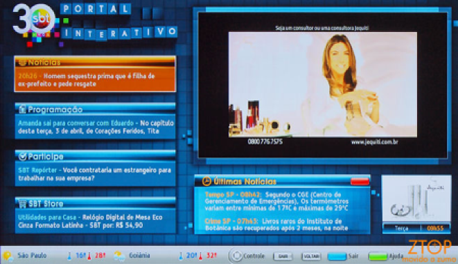

- 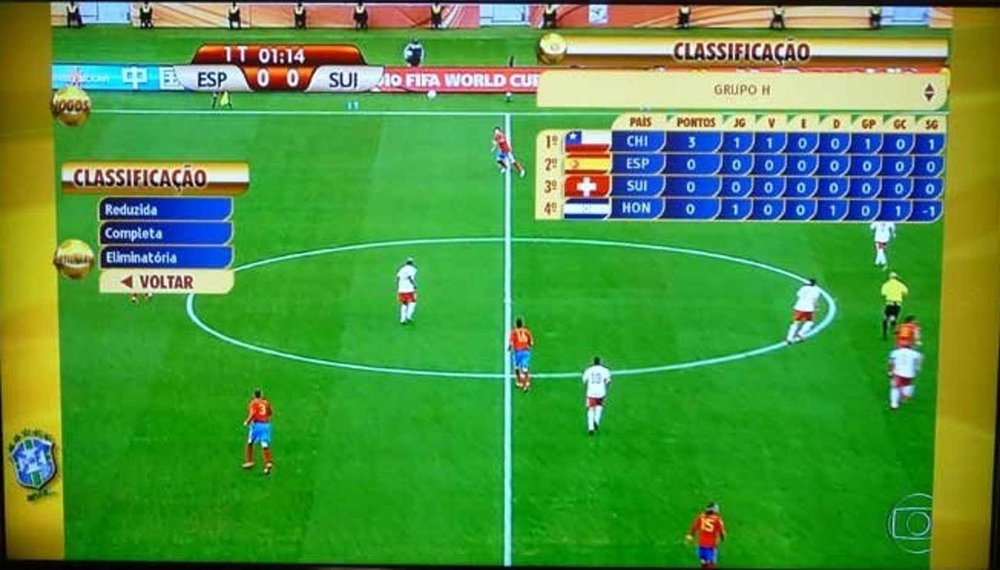

- 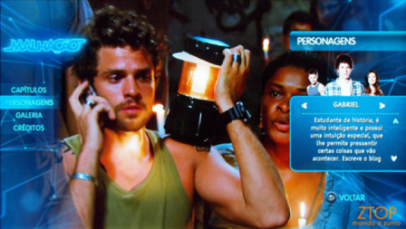

- 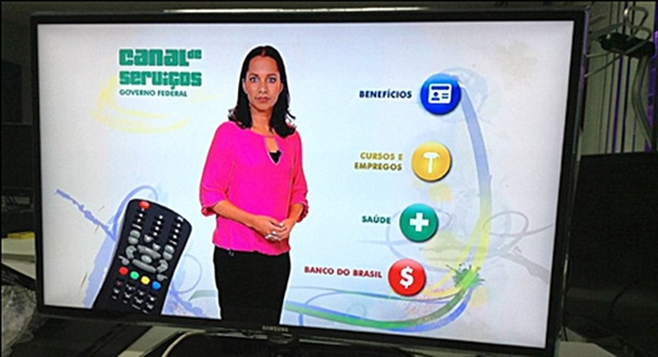

Definido na série de normas SBTVD ABNT 15606. Presente em receptores de TV Digital certificados no Brasil e América Latina (>60M telespectadores).

---

<!-- _class: cols-2 vcenter -->

# Ecossistema de Desenvolvimento Ginga é limitado

**Ausência de ambiente portátil e "zero-install"**: de fácil acesso, completo e aberto.
Podemos comparar o Mozilla (https://developer.mozilla.org/) e a Ginga-VM (2010)

- 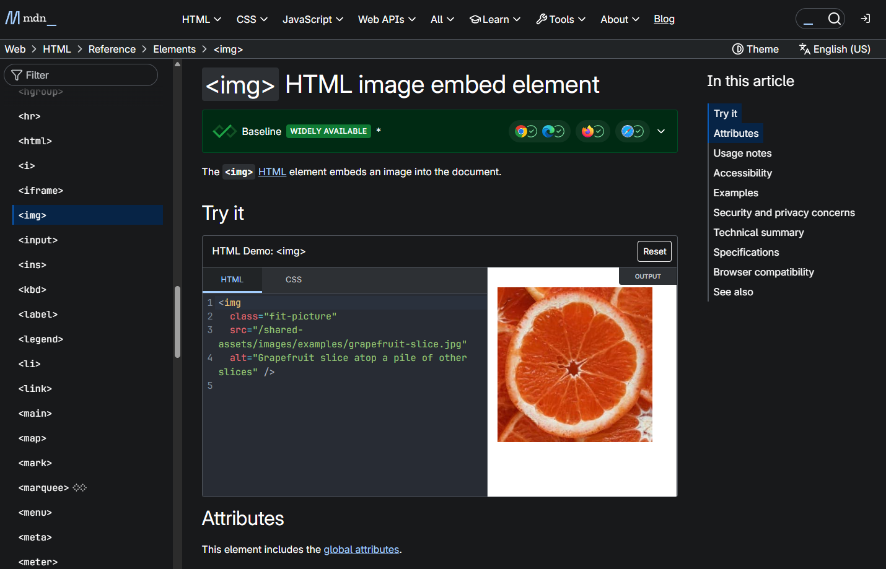

- 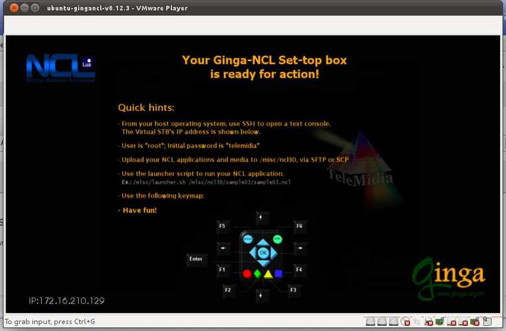

---

# Ecossistema de Desenvolvimento Ginga é limitado

**Um fator é a escolha da Engine Gráfica** (e.g., DirectFrameBuffer, FFmpeg, GStreamer, Browsers)

**Outro fator é a complexidade de certos componentes do Ginga**: NCLua (C-based lua engine), Ginga-HTML5 (chromium, webkit) e Ginga-CC-Webservices (HTTP server).

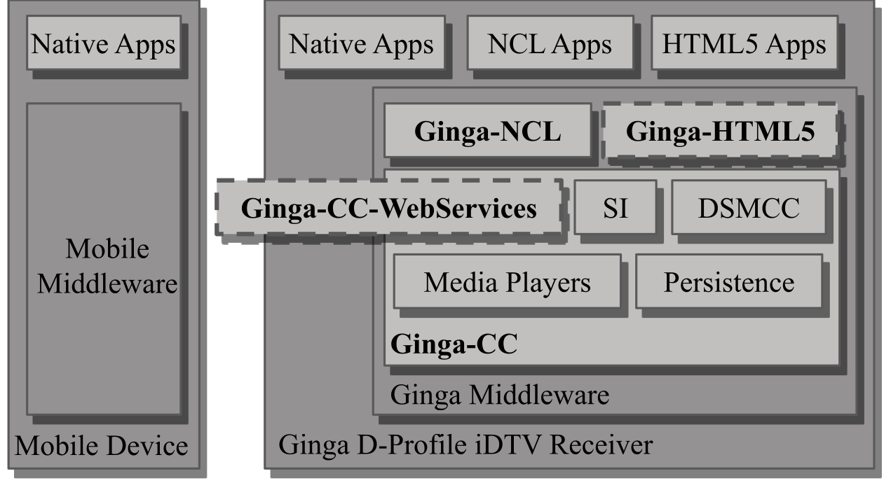

---

<!-- _class: cols-3 center -->

# Implementações do Ginga na Literatura

- **1998 — PUC-Rio (Netscape)**

  [Rodrigues et al. 1998]

  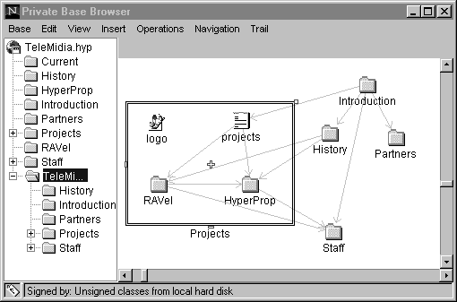

  Plugin para navegador Netscape no início da WWW.

  browser-only · sem Lua

- **2001 — PUC-Rio (Java AWT)**

  [Rodrigues et al. 2001]

  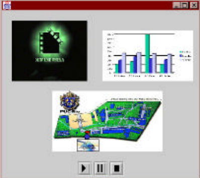

  Ferramentas de exibição hipermídia sobre Java AWT.

  desktop-only · sem Lua

- **2010 — PUC-Rio (C++ & FFmpeg)**

  [Soares et al. 2010]

  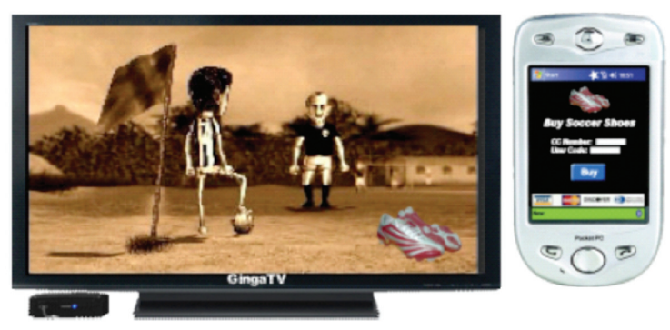

  Middleware declarativo com backend FFmpeg para IPTV/DTV.

  desktop-only

---

<!-- _class: cols-3 center -->

# Implementações do Ginga na Literatura

- **2012 — UFSCar (WebNCL)**

  [Melo et al. 2013]

  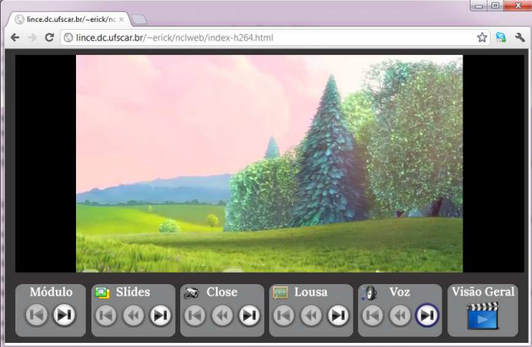

  Apresentador web puramente em JavaScript.

  browser-only · sem Lua

- **2018 — PUC-Rio (C++ & GStreamer)**

  [PUC-Rio / Telemídia]

  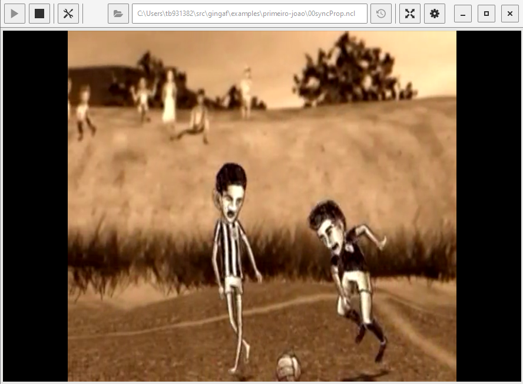

  Reimplementação C++ com `tick()` e GStreamer.

  desktop-only · sem CCWS

- **2018–2020 — Sidia NuGinga (NodeJS)**

  [Braga et al. 2018; Nogueira et al. 2020]

  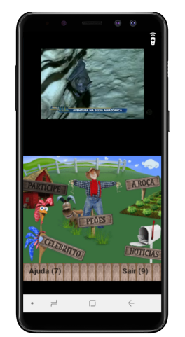 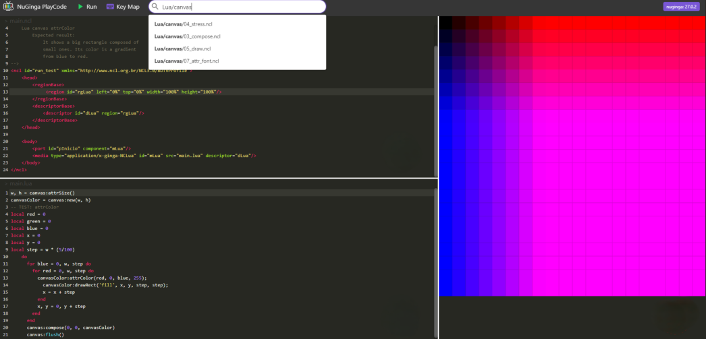

  Middleware JS/Android e ferramenta web Playcode.

  browser-only · sem CCWS

---

# Implementações do Ginga na Literatura

- **PUC-Rio (Java AWT)**
  **PUC-Rio (C++, FFmpeg)**
  **PUC-Rio (C++, GStreamer)**

-

- **PUC-Rio (Netscape)**
  **UFSCar (WebNCL)**
  **Sidia NuGinga (NodeJS)**

- **Native**
  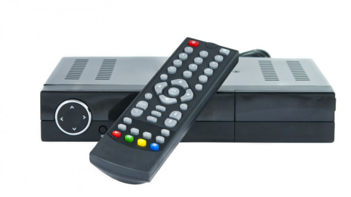 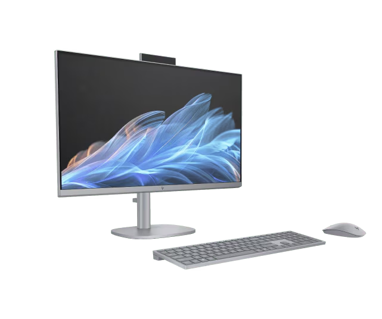

-

- **Browser**
  

---

<!-- _class: invert -->
<!-- _paginate: skip -->

# Solução Proposta

---

<!-- _class: grid-2x2 -->

# Solução Proposta: gingaf

As principais decisões de design são:

- **1. Engine Gráfica Multiplataforma**
  Código único em Dart/Flutter para execução consistente na Web, Desktop e Mobile.

- **2. UI e Modelos Desacoplados**
  Lógica (`NCLDocument`) independente e isolada de rendering.

- **3. Relógio Virtual**
  Avanço temporal determinístico orquestrado via `tick()`, eliminando condições de corrida.

- **4. NCLua e CCWS Portáveis**
  Runtime Lua puro em Dart e virtualização de rede sem dependências nativas.

---

<!-- _paginate: hold -->

# 1. Engine Gráfica Multiplataforma

- **PUC-Rio (Java AWT)**
  **PUC-Rio (C++, FFmpeg)**
  **PUC-Rio (C++, GStreamer)**

- gingaf (ours)
  Ginga-NCL + Ginga-HTML5

- **PUC-Rio (Netscape)**
  **UFSCar (WebNCL)**
  **Sidia NuGinga (NodeJS)**

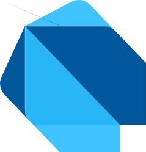 **Dart**  **Flutter**

- **Native**
   

-

- **Browser**
  

---

<!-- _class: cols-4 center -->

# 1. Engine Gráfica Multiplataforma

- 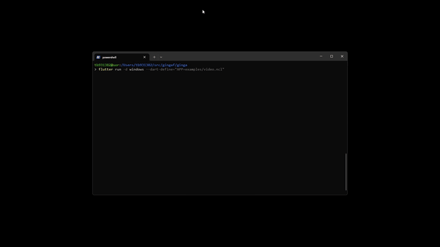
  **Windows**

- 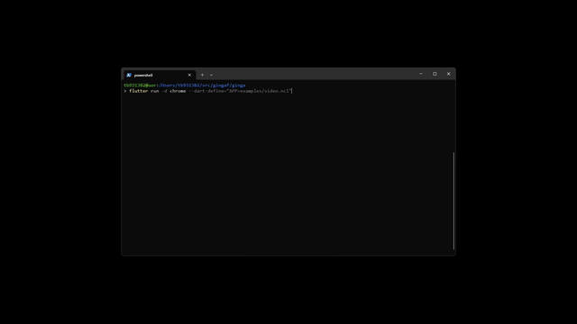
  **Chrome**

- 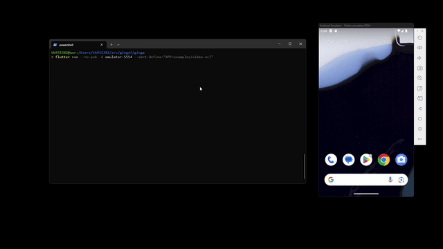
  **Android**

- 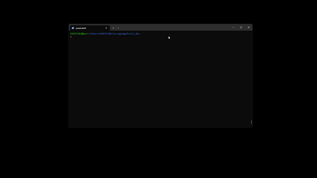
  **CLI**

---

<!-- _class: cols-2 vcenter -->

# 2. UI e Modelos Desacoplados

- **Camada de Lógica (Dart Puro)**
  `NCLDocument` (Parser, runtime NCLua) e `CCWS`. Compila para JavaScript e WebAssembly.

  **Camada de Apresentação (Flutter)**
  `NCLWidget` e `HTMLWidget` (webview, js-interop). Renderização com precisão de pixels na Web, desktop e mobile.

- 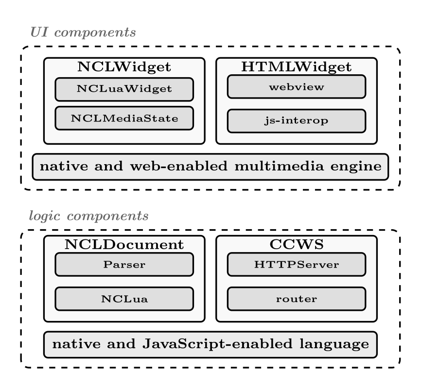

---

<!-- _class: cols-2 vcenter -->

# 3. Relógio Virtual

## Implementações Anteriores Sem Relógio Virtual

- **Acoplamento Temporal**
  Tempo atrelado ao relógio e threads do SO.

  **Bloqueio por Renderização**
  Máquina de estados bloqueada por chamadas `draw()`.

  **Eventos Nativos**
  Transições disparadas via `onEvent()` nativo.

- 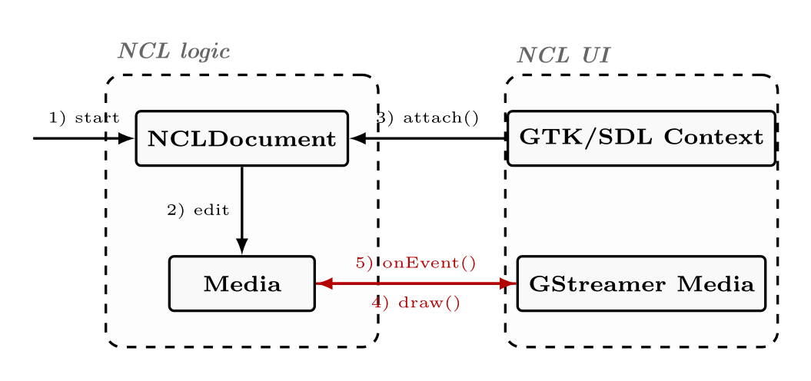

---

<!-- _class: cols-2 vcenter -->

# 3. Relógio Virtual

- **Coordenação por `tick()`**
  O `NCLWidget` avança o relógio virtual por pulsos explícitos.

  **Desacoplamento de UI**
  Sem referência direta entre `NCLDocument` e widgets da UI.

  **Sincronização Determinística**
  Estados de `Media` atualizados na ordem do documento, e a UI obtém propriedades via `syncProperties()` sem condições de corrida.

- 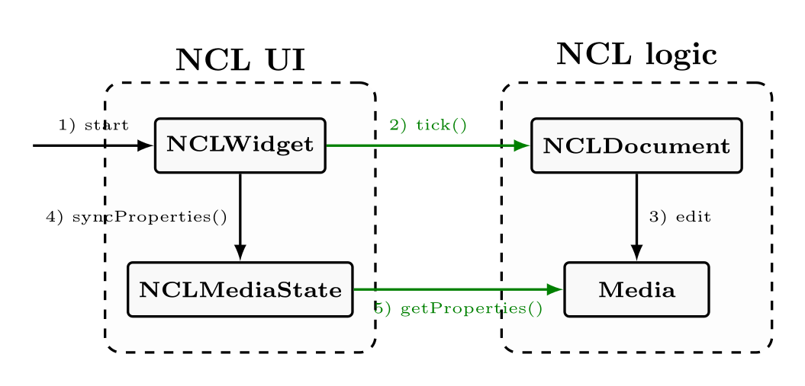

---

<!-- _class: cols-2 vcenter -->

# 4. NCLua Portável

- **Motor Lua em Dart Puro**
  `lua_dardo` (Lua 5.3) na Web sem dependências C ou Wasm.

  **Abstração de Comandos e Corrotinas**
  Chamadas `canvas` despachadas para o `CustomPainter` do Flutter, e corrotinas mapeadas para `async/await` sem bloquear o `tick()`.

  **Paridade Multiplataforma**
  Saída visual idêntica na Web (WebGL), Desktop e Mobile.

- 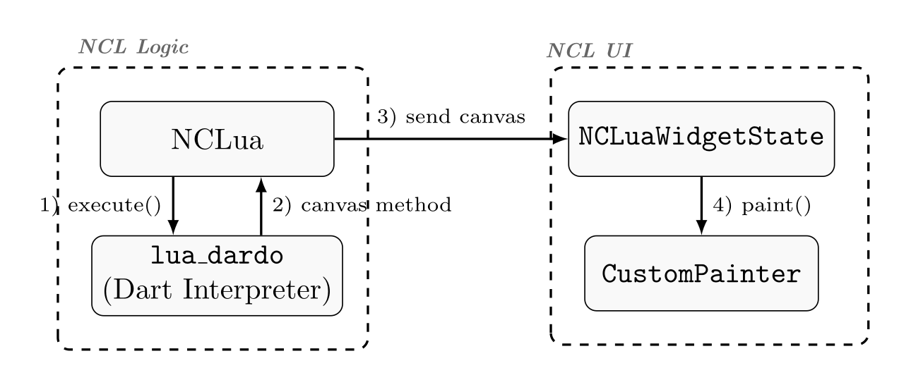

  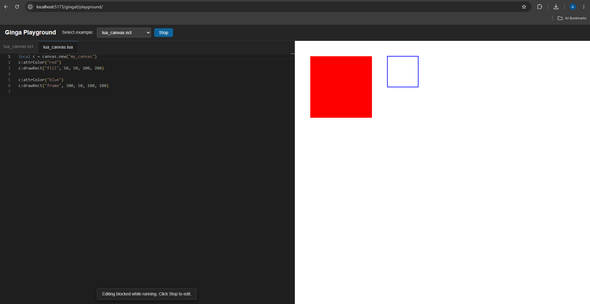

---

<!-- _class: cols-2 vcenter -->

# 4. Ginga-CC-WebServices Portável

- **Nativo (a)**
  Aplicação HTML executa em WebView nativa, enquanto `HTTPServer` local embutido (porta 44642) atende requisições HTTP.

  **Navegador com Sandbox (b)**
  Aplicação HTML executa em `iframe` com sandbox, com shim injetado que intercepta `window.fetch()` e `XMLHttpRequest`.

- 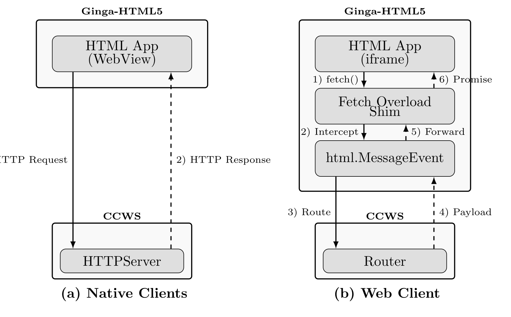

---

<!-- _class: invert -->
<!-- _paginate: skip -->

# Funcionalidades e Demo do gingaf

---

<!-- _class: grid-2x2 center -->

## NCL com Links, Grade de Vídeos, NCL Embutido e Navegação

- 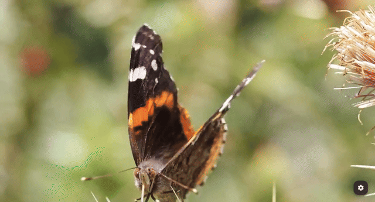
  NCL com links básicos ([video.ncl](https://ginga.org.br/gingaf/playground/?app=video.ncl))

- 
  NCL com grade de vídeos ([video_grid.ncl](https://ginga.org.br/gingaf/playground/?app=video_grid.ncl))

- 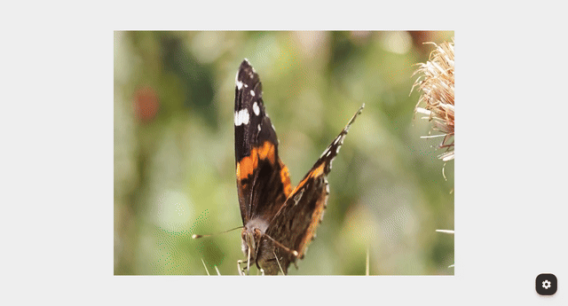
  NCL embutido em NCL ([emb_ncl.ncl](https://ginga.org.br/gingaf/playground/?app=emb_ncl.ncl))

- 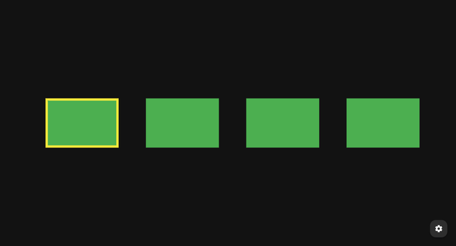
  NCL com navegação de foco e seleção ([focus_nav.ncl](https://ginga.org.br/gingaf/playground/?app=focus_nav.ncl))

---

<!-- _class: grid-2x2 center -->

## NCLua, HTML+CCWS, HTML Embutido e Multiusuário

- 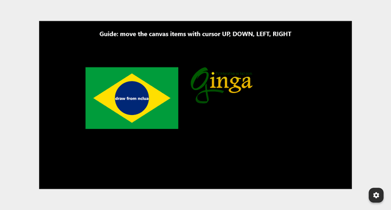
  NCL com desenho em tela Lua e teclas ([lua_canvas.ncl](https://ginga.org.br/gingaf/playground/?app=lua_canvas.ncl))

- 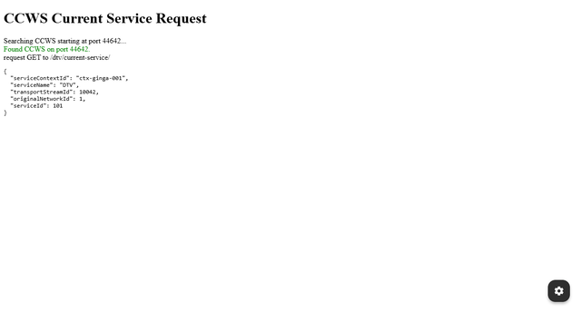
  HTML com CCWS /current-service/ ([current_service.html](https://ginga.org.br/gingaf/playground/?app=current_service.html))

- 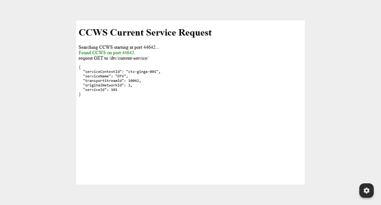
  NCL com documento HTML embutido ([emb_html.ncl](https://ginga.org.br/gingaf/playground/?app=emb_html.ncl))

- 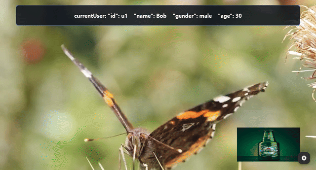
  NCL com troca de perfil multiusuário ([multiuser_profile/main.ncl](https://ginga.org.br/gingaf/playground/?app=multiuser_profile/main.ncl))

---

# Esta apresentação vai para o Guinness Book de 2027?

---

# Esta apresentação vai para o Guinness Book de 2027?

## Primeiro exemplo de NCL forward na história!

---

# Contribuições

## Portabilidade Multiplataforma

- Suporte a **Desktop**, **Web** e **Android**, pronto para **dispositivos futuros** (ex.: TVs com suporte a Flutter).

- 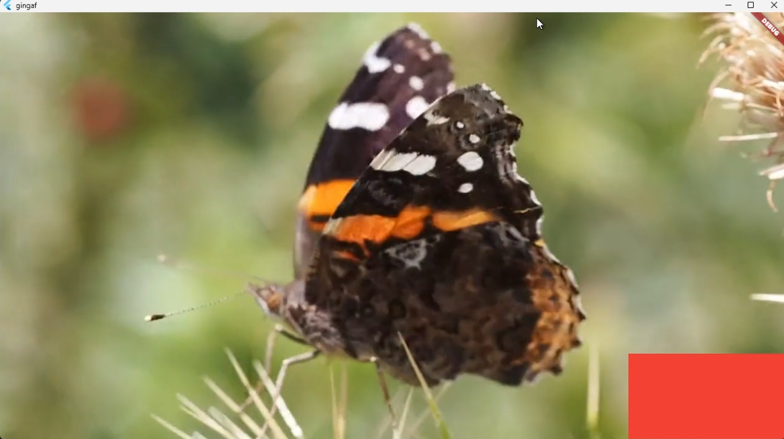 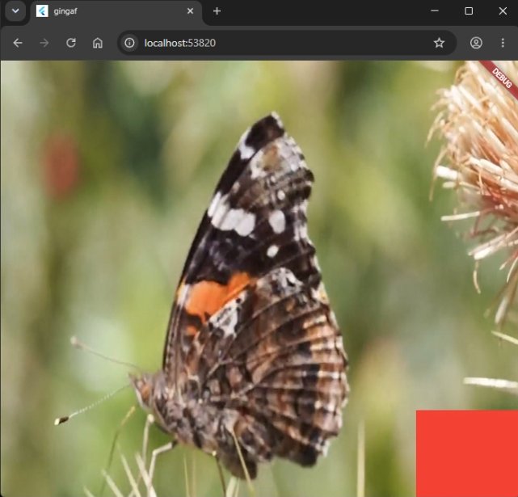 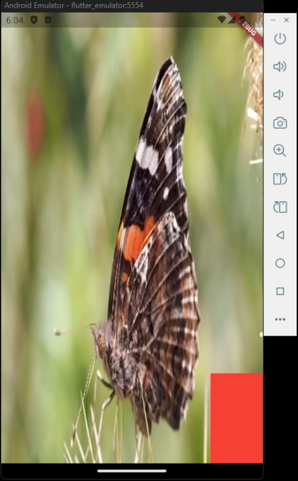

**Decisões de Arquitetura**

- **1. Engine Gráfica**
  Dart/Flutter unificado

- **2. UI Desacoplada**
  Lógica headless em memória

- **3. Relógio Virtual**
  Avanço via `tick()`

- **4. NCLua & CCWS**
  Lua e CCWS virtualizados

---

# Contribuições

## Determinismo

- Modo **headless** em memória, avanço por `tick()` orquestrado e **64 testes unitários** em CI.

- 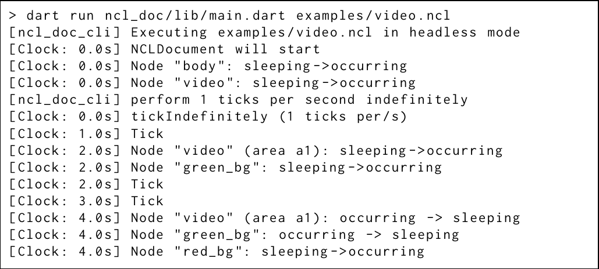

**Decisões de Arquitetura**

- **1. Engine Gráfica**
  Dart/Flutter unificado

- **2. UI Desacoplada**
  Lógica headless em memória

- **3. Relógio Virtual**
  Avanço via `tick()`

- **4. NCLua & CCWS**
  Lua e CCWS virtualizados

---

# Contribuições

## Debug

- Extensão **ginga-code** para VS Code com inspeção **passo a passo** (step) sem necessidade de hardware STB.

- 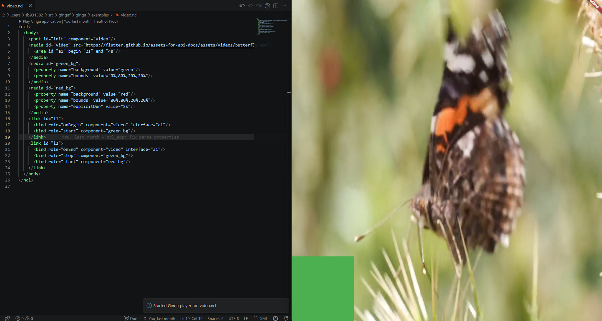

**Decisões de Arquitetura**

- **1. Engine Gráfica**
  Dart/Flutter unificado

- **2. UI Desacoplada**
  Lógica headless em memória

- **3. Relógio Virtual**
  Avanço via `tick()`

- **4. NCLua & CCWS**
  Lua e CCWS virtualizados

---

# Referências

- **[Rodrigues et al. 1998]** Rogério Ferreira Rodrigues, Débora C. Muchaluat-Saade, and Luiz Fernando Gomes Soares. "Composite nodes, contextual links and graphical structural views on the WWW." *Journal of the Brazilian Computer Society*, 5(2), 1998.
- **[Rodrigues et al. 2001]** Rogério Ferreira Rodrigues, Leandro Marques Rodrigues, and Luiz Fernando Gomes Soares. "Desenvolvimento e Integração de Ferramentas de Exibição em Sistemas de Apresentação Hipermídia." *VII Simpósio Brasileiro de Sistemas Multimídia e Hipermídia (SBMídia 2001)*, Florianópolis, SC, 2001.
- **[Soares et al. 2010]** Luiz Fernando Gomes Soares, Carlos de Salles Soares Neto, Rogério Ferreira Rodrigues, and Marcelo Ferreira Moreno. "Ginga-NCL: Declarative middleware for multimedia IPTV services." *IEEE Communications Magazine*, 48(6): 74–81, 2010.
- **[Melo et al. 2013]** Erick Lazaro Melo, Caio César Viel, Cesar A. C. Teixeira, Alexandre Coelho Rondon, and Daniel de Paula Silva. "WebNCL: a web-based presentation machine for multimedia documents." *Proceedings of the 19th Brazilian Symposium on Multimedia and the Web (WebMedia 2013)*, 2013.
- **[Braga et al. 2018]** Rodrigo Braga, Volnei Klehm, Leonardo Santana, Kevin Takano, Lauro Gama, Addison Lima, Vinícius Melo, Taynara Paiva, Diego Gonzalez, Michael Mello, Chak Lee, and Lois Nascimento. "NuGinga: a JavaScript Driven Implementation of Brazilian Digital TV Middleware for Android." *Proceedings of the 24th Brazilian Symposium on Multimedia and the Web (WebMedia 2018)*, Salvador, Brazil, 2018.
- **[Nogueira et al. 2020]** Dina Nogueira, Lois Nascimento, Michael Mello, and Rodrigo Braga. "NuGinga Playcode: A web NCL/NCLua authoring tool for Ginga-NCL digital TV applications." *Proceedings of the 26th Brazilian Symposium on Multimedia and the Web (WebMedia 2020)*, 2020.

---

<!--
_paginate: false
_header: ""
_class: cols-2 vcenter
-->

# Obrigado!

- ### Dúvidas e Discussão

  **Repositório**: https://github.com/ginga-org-br/gingaf

  **Playground**: https://ginga.org.br/gingaf/playground/

  **Contato**: `a.guedes@reading.ac.uk` | `danielmoraes@telemidia.puc-rio.br`

- 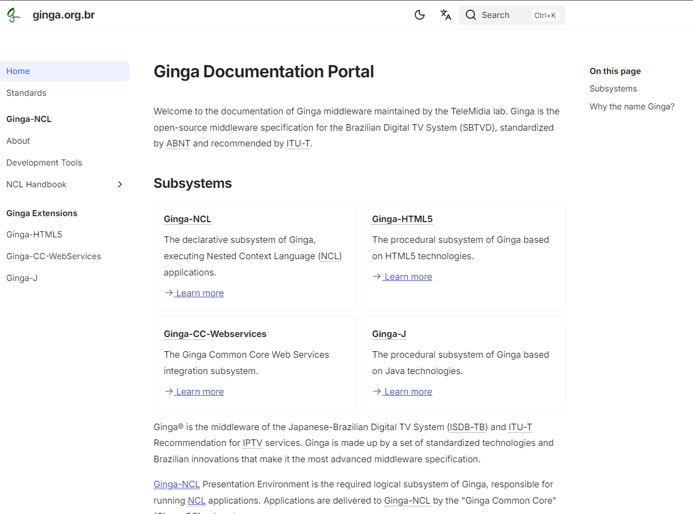
